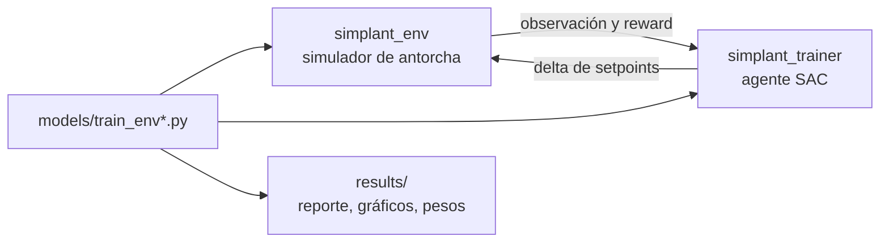

# SimPlant Trainer

SimPlant Trainer entrena un agente Soft Actor-Critic (SAC) que controla la antorcha (flare) de una planta simulada.

- El agente ajusta setpoints. No opera válvulas de seguridad.
- La válvula de alivio (PSV) es automática. Abre cuando la presión aguas arriba supera 99.0 kg/cm²-g.
- El orden de prioridad de los objetivos es: seguridad, emisiones, gas recuperado.



## Escenarios

| Script | Escenario | Observación | Acciones |
| --- | --- | --- | --- |
| `models/train_env.py` | Con sistema de recuperación de gas (FGRS) | 22 variables | 5: FGRS, vapor, purga, nivel KOD, setpoint PCV |
| `models/train_env2.py` | Sin FGRS | 19 variables | 3: vapor, purga, nivel KOD |

## Estructura

- `src/simplant_env/`: simuladores de la antorcha (entornos Gymnasium).
- `src/simplant_trainer/`: agente SAC, redes, buffer, checkpoints y exportación a ONNX.
- `models/`: scripts de entrenamiento.
- `results/`: archivos que genera cada entrenamiento.
- `tests/`: pruebas unitarias.

## Instalación

Requisito: Python 3.13 o superior.

1. Instale `uv`.

   Linux y macOS:

   ```bash
   curl -LsSf https://astral.sh/uv/install.sh | sh
   ```

   Windows:

   ```powershell
   powershell -ExecutionPolicy ByPass -c "irm https://astral.sh/uv/install.ps1 | iex"
   ```

2. Abra una terminal en la carpeta del proyecto.
3. Instale las dependencias.

   ```bash
   uv sync
   ```

Alternativa sin `uv`:

```bash
python -m venv .venv
source .venv/bin/activate
pip install -e .
```

## Entrenamiento

Ejecute los comandos desde la carpeta raíz del proyecto.

Escenario con FGRS:

```bash
uv run models/train_env.py
```

- El script escribe los resultados en `results/results_flare_env1/`.
- El repositorio incluye resultados de referencia en `results/results_flare_env_1/`.

Escenario sin FGRS:

```bash
uv run models/train_env2.py
```

- El script escribe los resultados en `results/results_flare_env2/`.

### Duración

La configuración por defecto ejecuta 405 000 pasos. El entrenamiento de referencia con FGRS tardó 2434 s.

Para una prueba corta, reduzca estas constantes en el script:

```python
NUM_EPOCHS = 200
STEPS_PER_EPOCH = 2000
WARMUP_STEPS = 5000
```

## Resultados

Cada entrenamiento genera cuatro archivos.

| Archivo | Contenido |
| --- | --- |
| `report.txt` | Comparación entre el agente y un control conservador, y matriz de cumplimiento |
| `sac_vs_conservative.png` | Episodio de 24 horas: agente contra control conservador |
| `training_curves.png` | Evolución del reward durante el entrenamiento |
| `*.safetensors` | Pesos del agente entrenado |

### `report.txt`

Lea la matriz de cumplimiento en este orden: seguridad, criterios ambientales, gas recuperado.

- `✅ CUMPLE`: el resultado alcanza el objetivo.
- `⚠️ BORDE`: el resultado está cerca del objetivo y por debajo de él.
- `❌ NO CUMPLE`: el resultado no alcanza el objetivo.

Los criterios de la matriz son los que el modelo representa. El reporte no reemplaza una validación regulatoria en planta.

Resultado de referencia con FGRS (episodio de 24 horas, `seed=42`):

| Métrica | Conservador | Agente SAC |
| --- | --- | --- |
| Gas recuperado (kg) | 6433 | 21343 |
| Eficiencia de combustión promedio | 0.994 | 0.997 |
| CO₂eq (ton) | 0.8 | 0.2 |
| Episodios sin parada de emergencia (60 episodios) | — | 100.0 % |

### `sac_vs_conservative.png`

- Compare la eficiencia de combustión (CE) de las dos curvas.
- Compare el flujo de gas recuperado de las dos curvas.

### `training_curves.png`

- Un reward que sube y después se estabiliza indica que el entrenamiento convergió.

### Archivos `.safetensors`

- Estos archivos contienen los pesos de las redes del agente.
- Son necesarios para cargar el agente entrenado en otro sistema. No los borre.

## Pruebas

```bash
uv run pytest
```
